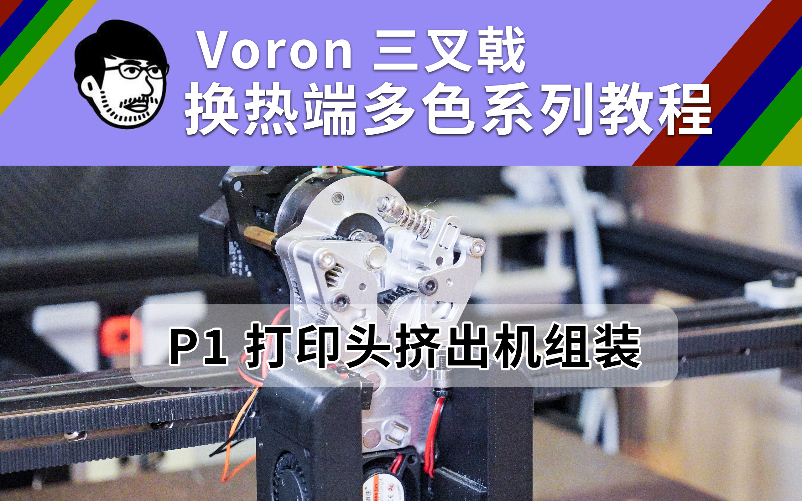

# 适用于VoronTrident的多热端换色系统

> 本项目基于 https://github.com/cx330-TXY/CxChanger

其他参考项目
1. MedusaHC https://github.com/Irbis3D/MedusaHC
2. Lineux-Hotswap https://github.com/3dfiyMyLife/Lineux-Hotswap
3. StealthChanger https://stealthchanger.com


BOM表 https://docs.qq.com/sheet/DSE9HbmJtdGJETFRU?tab=tddmch

视频教程 https://www.bilibili.com/video/BV1EwuK6BEEL/?spm_id_from=333.1387.collection.video_card.click



## OrcaSlicer
### 打印机设置

#### 基础信息

切片软件配置->不可打印区域设置 
>0x45, 299x45, 299x0, 0x0

#### 打印机G-code

打印起始g-code

```base
PRINT_START BED=[bed_temperature_initial_layer_single] INITIAL_TOOL=[initial_tool] TOOLS="{if is_extruder_used[0]}0,{endif}{if is_extruder_used[1]}1,{endif}{if is_extruder_used[2]}2,{endif}{if is_extruder_used[3]}3,{endif}{if is_extruder_used[4]}4,{endif}" TEMPS="{if is_extruder_used[0]}{nozzle_temperature_initial_layer[0]},{endif}{if is_extruder_used[1]}{nozzle_temperature_initial_layer[1]},{endif}{if is_extruder_used[2]}{nozzle_temperature_initial_layer[2]},{endif}{if is_extruder_used[3]}{nozzle_temperature_initial_layer[3]},{endif}{if is_extruder_used[4]}{nozzle_temperature_initial_layer[4]},{endif}"
```

更换耗材丝G-code

```base
M104 S{nozzle_temperature[next_extruder]} T{next_extruder}
T{next_extruder}
```

#### 挤出机

切换材料时的回抽量
长度 3mm (与配置中的variable_pickup_retract_len 相同)

### 工艺配置

质量-墙壁和表面
勾选首先打印填充

材料-Ooze预防
勾选开启
软化温度设置为 -80
预热时间35s

### 耗材颜色设置
