# 适用于VoronTrident的多热端换色系统

> 本项目基于 https://github.com/cx330-TXY/CxChanger

其他参考项目
1. MedusaHC https://github.com/Irbis3D/MedusaHC
2. Lineux-Hotswap https://github.com/3dfiyMyLife/Lineux-Hotswap
3. StealthChanger https://stealthchanger.com


BOM表 https://docs.qq.com/sheet/DSE9HbmJtdGJETFRU?tab=tddmch

视频教程 https://www.bilibili.com/video/BV1EwuK6BEEL/?spm_id_from=333.1387.collection.video_card.click


## OrcaSlicer


### 打印机设置

#### 基础信息


切片软件配置->不可打印区域设置
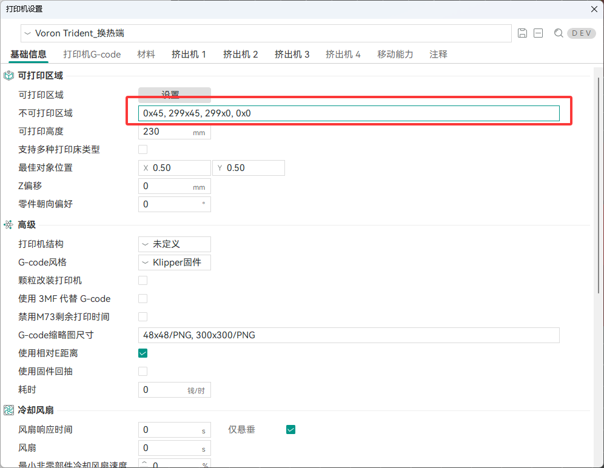
>0x45, 299x45, 299x0, 0x0

不可打印区域设置效果，灰色为禁用区
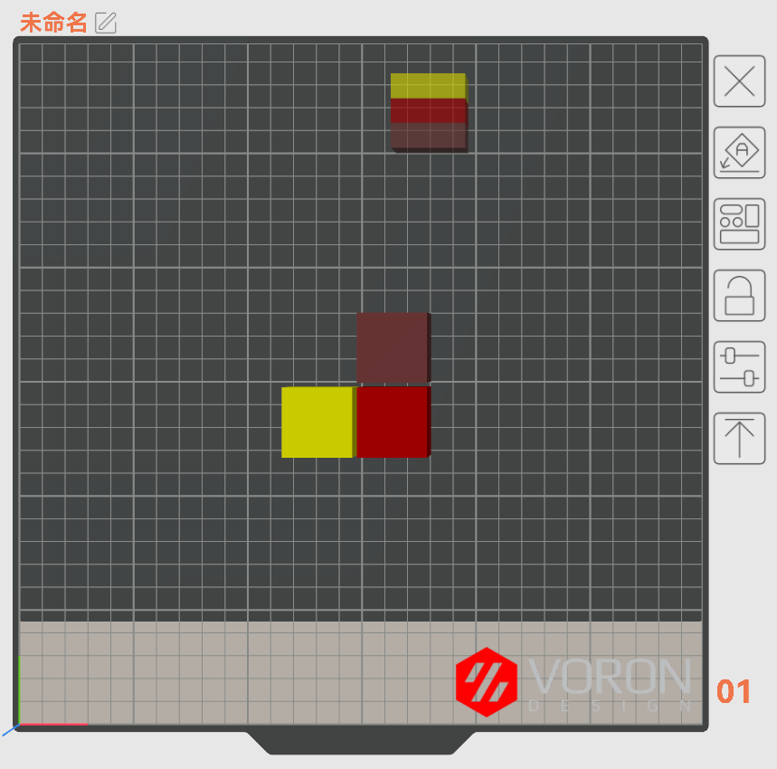

如果不愿意设置不可打印区域，也可以使用负坐标来定位停靠坞位置。

#### 打印机G-code

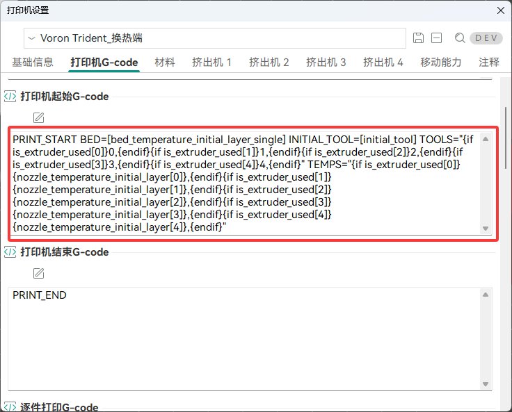

打印起始g-code

```base
PRINT_START BED=[bed_temperature_initial_layer_single] INITIAL_TOOL=[initial_tool] TOOLS="{if is_extruder_used[0]}0,{endif}{if is_extruder_used[1]}1,{endif}{if is_extruder_used[2]}2,{endif}{if is_extruder_used[3]}3,{endif}{if is_extruder_used[4]}4,{endif}" TEMPS="{if is_extruder_used[0]}{nozzle_temperature_initial_layer[0]},{endif}{if is_extruder_used[1]}{nozzle_temperature_initial_layer[1]},{endif}{if is_extruder_used[2]}{nozzle_temperature_initial_layer[2]},{endif}{if is_extruder_used[3]}{nozzle_temperature_initial_layer[3]},{endif}{if is_extruder_used[4]}{nozzle_temperature_initial_layer[4]},{endif}"
```

更换耗材丝G-code

```base
M104 S{nozzle_temperature[next_extruder]} T{next_extruder}
T{next_extruder}
```

#### 材料
取消单挤出机多材料的勾

挤出机输入热端数量


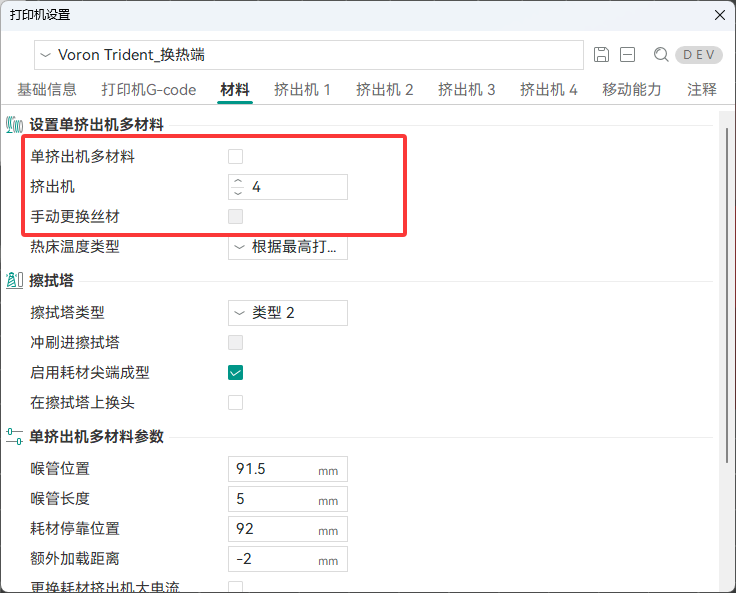


#### 挤出机

切换材料时的回抽量
长度 3mm (与配置中的variable_pickup_retract_len 相同)
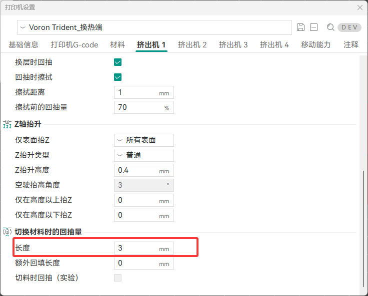

### 工艺配置

质量-墙壁和表面
勾选首先打印填充
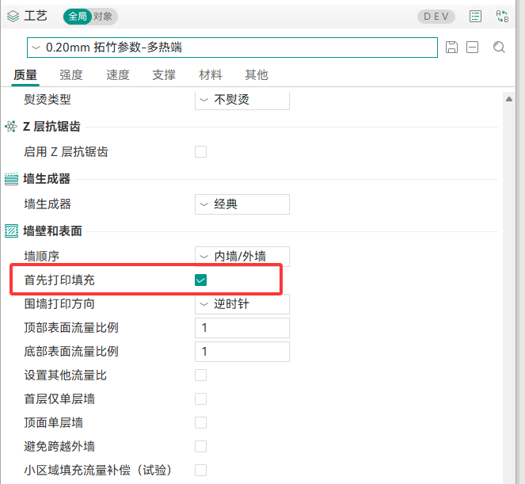

材料-Ooze预防
勾选开启
软化温度设置为 -80
预热时间35s
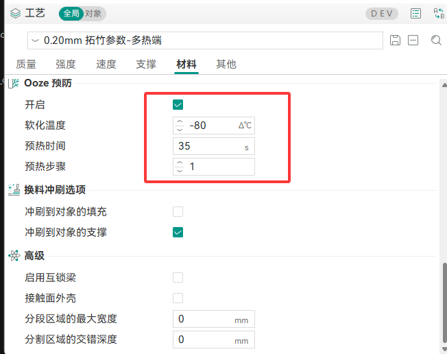

### 耗材颜色设置
通过在左侧耗材丝列表进行匹配
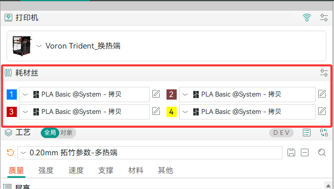

## Klipper配置

> *注意：所有配置文件均为实验性质，不对因使用此文件造成的一切后果负责。

需要安装klipper-toolchanger https://github.com/viesturz/klipper-toolchanger 

登录到上位机执行安装命令

```shell
wget -O - https://raw.githubusercontent.com/viesturz/klipper-toolchanger/main/install.sh | bash
```

将 MH 文件夹中的所有文件 以及 myvariables.cfg  放入 Klipper 配置文件中

### Klipper 配置文件目录说明

```text
Klipper/
├── printer.cfg                    # 主配置：MCU、运动系统、热床、打印机宏等
├── myvariables.cfg                # SAVE_VARIABLE 持久化数据：工具偏移、当前工具及统计值
├── ebb.cfg                        # EBB MCU、板载温度传感器和 LIS2DW 加速度计
├── eddy.cfg                       # Eddy 探头、Z 倾斜调整和热床网格
└── MH/
    ├── calibration.cfg            # 工具高度/偏移校准和保存校准结果的宏
    ├── dock_locate_calibrate.cfg  # 多热端停靠坞位置校准（非必须）
    ├── eddy_tap_z.cfg             # 使用 Eddy TAP 校准各工具的 Z 偏移（非必须）
    ├── extruder.cfg               # E0–E3 挤出机、加热器和驱动器配置
    ├── fan.cfg                    # 模型冷却风扇、热端风扇和停靠坞风扇
    ├── macro.cfg                  # 温度、暂停/恢复、取消打印等通用宏
    ├── setting                    # 备用文件
    └── swap.cfg                   # 多热端换刀、停靠位置、传感器检查和故障恢复
```
新增的特色功能
1. 自动反推热端停靠坞的坐标（实验性）
2. 获取热端时验证工具头是否已挂载热端，如果已挂载则停止获取新的热端
3. 在获取和卸载热端时，如果出错会进行第二次尝试，再次失败会自动进行XY归位校准，再次尝试，如依然失败则停止运行，如在打印中则触发暂停，手动放置好热端之后，再手动执行开始打印。
4. 归位时，先进行Y归位，再进行X归位，避免碰撞停靠坞。进行XYZ偏移校准时也是如此。

`printer.cfg` 通过`[include MH/*.cfg]` 加载 MH 文件夹中的所有配置文件，`myvariables.cfg` 为保存变量的文件，无须引入

`calibration.cfg ` 需配置 对刀器 pin 以及 对刀器坐标


#### 自动反推停靠坞坐标使用说明
> 该功能根据 https://github.com/3dfiyMyLife/Lineux-Hotswap 作者提供的代码修改而来

1. 打开 `dock_locate_calibrate.cfg` 

- 1. 根据自己配置文件XY的微步设置，选择对应的 `xy_resolution`
- 2. 根据自己打印机的归零坐标位置，设置 x_endstop 和 y_endstop

2. 需将 `klippy\extras\dock_locate_calibrate.py` 放入上位机的同目录中。
3. 将热端挂载到工具头，禁用电机，手动推入停靠坞的位置 

    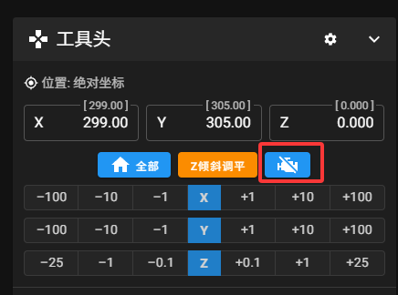
    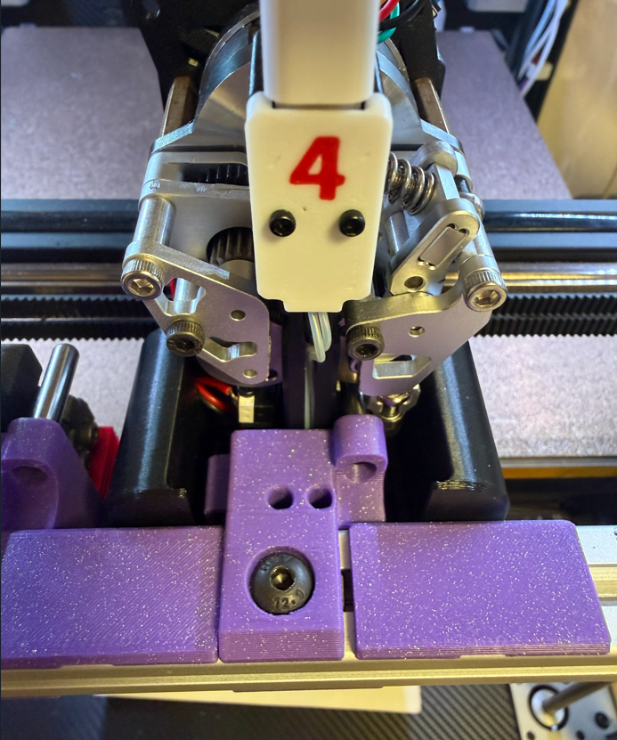

4. 然后执行 dock_locate_calibrate 宏。
5. 查看控制台输入，注意：该坐标可能有一定的误差，最好手动慢慢调整到这个坐标观察是否到位。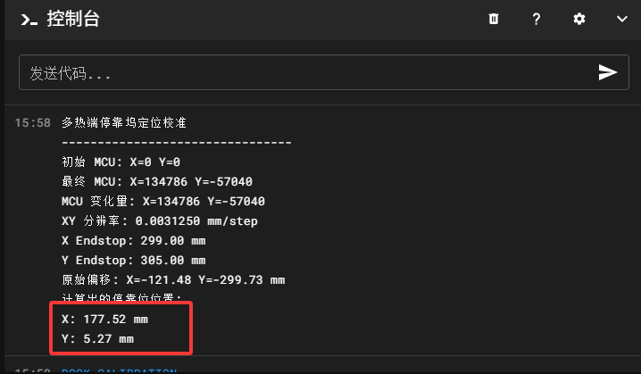

#### 需进行必要配置的内容

- Klipper\MH\calibration.cfg

```base
[tools_calibrate]
pin: ^PF4                   #对刀器引脚

[gcode_macro _TOOL_CALIB_VARS]
variable_sensor_x: 290      # 校准传感器的中心X坐标
variable_sensor_y: 20       # 校准传感器的中心Y坐标
variable_safe_x: 290        # 换刀/待机的安全区域X
variable_safe_y: 45         # 换刀/待机的安全区域Y
variable_safe_z: 10.0       # 换刀/待机的安全区域Z高度
variable_tool_count: 4      # 工具总数 (例如0, 1，共2个)
```

执行 CALIBRATE_TOOL 可选择单个热端进行校准

执行 CALIBRATE_ALL_TOOLS 可自动校准所有热端


- Klipper\MH\extruder.cfg

需配置多个热端的 heater_pin 和 sensor_pin

并对多个热端进行pid校准

```base
PID_CALIBRATE HEATER=extruder TARGET=245
PID_CALIBRATE HEATER=extruder1 TARGET=245
PID_CALIBRATE HEATER=extruder2 TARGET=245
PID_CALIBRATE HEATER=extruder3 TARGET=245
```

- Klipper\MH\fan.cfg

对热端风扇和模型散热风扇进行配置

- Klipper\MH\macro.cfg

需检查是否有同名宏，如果有请在原来的位置删掉或注释
检查暂停位置是否与停靠坞坐标冲突
```
[gcode_macro PAUSE]
rename_existing: BASE_PAUSE
gcode:
    # ----- 参数设置 -----
             ; 停车位置 X 坐标
              ; 停车位置 Y 坐标

```


- Klipper\MH\swap.cfg

配置热端传感器引脚
```base
[gcode_button tool_sensor]
pin: EBB:PD0
```

调试速度切换
```
variable_feed_fast:        10000 # 工作速度（空驶）
# variable_feed_fast:       1000  # 测试速度
variable_feed_slow:        1000  # 工作速度（受力）
# variable_feed_slow:        80  # 测试速度（受力）
```

停靠动作距离设置
```
variable_dock_shift_x: -3   # 横移开挤出机距离
variable_dock_dodge_y: 15     # 避让动作的 Y 轴相对位移
variable_dock_safe_y:  40     # 安全拔出的 Y 轴相对位移
```

停靠坞坐标设置

```
# T0 配置
variable_t0_dock_x: 13.6 
variable_t0_dock_y: 5 

# T1 配置
variable_t1_dock_x: 68  
variable_t1_dock_y: 5

# T2 配置
variable_t2_dock_x: 123  
variable_t2_dock_y: 5.1

# T3 配置 
variable_t3_dock_x: 177 
variable_t3_dock_y: 5.1 
```

- Klipper\ebb.cfg
Can配置文件，注释掉原有的挤出机和风扇配置

- Klipper\ebb.cfg
由于调整了热床位置，需更改 z_tilt 和 bed_mesh 坐标

```
[z_tilt]
points: #测量点的位置 
  30, 50
  150, 245
  270, 50

[bed_mesh]
mesh_min: 20, 77 
mesh_max: 280, 280
```

- Klipper\myvariables.cfg

无需修改，注意， `current_tool` 的值为 -1 时表示工具头未挂载任何热端，请与实际情况同步。

- Klipper\printer.cfg

1. 引入 `[include MH/*.cfg]` 注意需在 `[include mainsail.cfg]` 下方，以便保证所有宏被正确重写。

2. 重写 PRINT_START 和 PRINT_END 宏


### 调试流程
1. 设置所有热端的停靠坞坐标，先进行慢速测试，再进行正常速度测试。
2. 设置校准器的坐标，手动测试完成后，执行全部校准。
3. 对热端进行PID校准。
4. 检查所有热端风扇和模型风扇工作正常。